<div align="center">



<a href="https://github.com/CriminalFlower">
  
</a>

<br/>


</div>

---

### 🌌 Обо мне

```kotlin
object Mikhail {
    val role      = "Plugin & Android Developer"
    val focus     = listOf("Telegram-клиенты", "UI/UX", "Автоматизация", "AI-агенты")
    val languages = listOf("C++", "Java")
    val status    = "Притягиваю идеи, как чёрная дыра — свет"
}
```

- 🛰 Делаю **неофициальные клиенты и плагины для Telegram**
- 📱 Пишу **Android-приложения** и уделяю внимание интерфейсу
- 🤖 Собираю **AI-агентов** и автоматизирую рутину
- 🧪 Люблю эксперименты: от низкоуровневого C++ до быстрых прототипов

### 🪐 Проекты

<table>
<tr>
<td width="50%" valign="top">

#### [⚡ FlashGram](https://github.com/CriminalFlower/FlashGram)
Неофициальный клиент Telegram Desktop для Windows.


</td>
<td width="50%" valign="top">

#### 🔭 Новые проекты
Telegram-плагины, Android-приложения и AI-агенты — скоро здесь.


</td>
</tr>
</table>

### 🛠 Стек

<div align="center">


<br/>


</div>

### 📡 Связь

<div align="center">

[](https://github.com/CriminalFlower)

<sub>✦ Всё, что попадает за горизонт событий, становится кодом ✦</sub>

</div>
